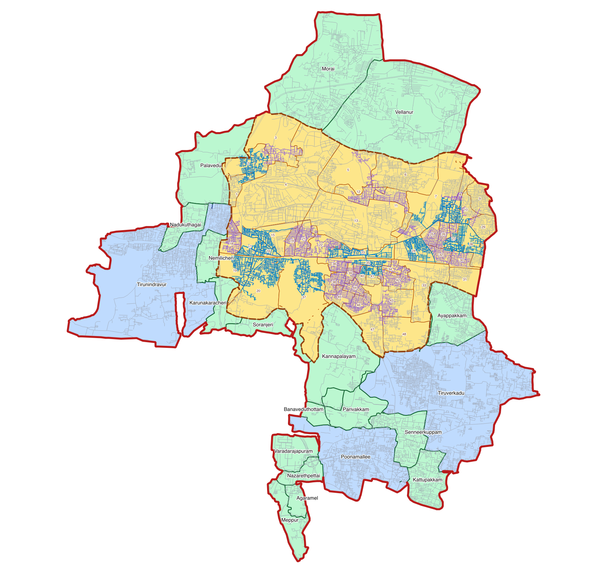

# Avadi GIS datasets

GIS data for the current Avadi Corporation area and the proposed expansion
described in **G.O. (Ms) No. 201, MAWS (Elections), 31 December 2024**.
The datasets include boundaries, roads, water and sewer infrastructure, and
natural drainage.

All layers use **WGS 84 / EPSG:4326**. The data is intended for mapping,
analysis, and planning. It is not a legal boundary survey.

## Download

| Package                                    | Download                                                                 |
| ------------------------------------------ | ------------------------------------------------------------------------ |
| All layers in one GeoPackage               | [`avadi_gis.gpkg`](avadi_gis.gpkg)                                       |
| All boundary layers as GeoJSON             | [`boundaries/`](boundaries/)                                             |
| All road layers as GeoJSON                 | [`roads/`](roads/)                                                       |
| All pipeline and utility layers as GeoJSON | [`pipelines/`](pipelines/)                                               |
| Natural drainage as GeoJSON                | [`drainage/natural_drainage.geojson`](drainage/natural_drainage.geojson) |
| Shapefile components                       | [`shapefiles/`](shapefiles/)                                             |

The GeoPackage is the simplest option for QGIS and other GIS applications.
GeoJSON files can be opened directly in QGIS, ArcGIS, GeoPandas, and most web
mapping tools. Shapefiles are provided as their complete component sets
(`.shp`, `.shx`, `.dbf`, `.prj`, and `.cpg`) under [`shapefiles/`](shapefiles/).

## Preview

## Area summary

| Area                            | Approximate size |
| ------------------------------- | ---------------: |
| Avadi today: 48 wards           |         65.0 km² |
| Areas proposed for addition: 20 |        105.6 km² |
| Proposed expanded Avadi         |    **170.7 km²** |

## Boundary datasets

| Dataset                      | Description                                                                                                                                       | Download                                                   |
| ---------------------------- | ------------------------------------------------------------------------------------------------------------------------------------------------- | ---------------------------------------------------------- |
| `avadi_wards_current`        | Current Avadi Corporation wards, based on the 48-ward `/lb` map. Slivers between wards are assigned to the nearest ward.                          | [`GeoJSON`](boundaries/avadi_wards_current.geojson)        |
| `avadi_wards_tngis_original` | The original 48 TNGIS wards, retained for comparison. Their published area is approximately 62.1 km².                                             | [`GeoJSON`](boundaries/avadi_wards_tngis_original.geojson) |
| `avadi_go429_added_areas`    | The 20 areas named in the government order, one feature per area. Includes gazette item, panchayat union, LGD code, area, and related attributes. | [`GeoJSON`](boundaries/avadi_go429_added_areas.geojson)    |
| `avadi_expanded_units`       | The proposed expanded corporation represented as 88 units with no gaps or overlaps.                                                               | [`GeoJSON`](boundaries/avadi_expanded_units.geojson)       |
| `avadi_boundaries`           | Current and proposed expanded outlines.                                                                                                           | [`GeoJSON`](boundaries/avadi_boundaries.geojson)           |

### Areas named in the proposed expansion

The order proposes adding the following areas in full:

- **Municipalities:** Poonamallee, Tiruverkadu, and Tirunindravur.
- **Villivakkam union village panchayats:** Vellanur, Ayappakkam, Palavedu,
  and Morai.
- **Poonamallee union village panchayats:** Nemilicheri, Nadukuthagai,
  Kattupakkam, Senneerkuppam, Varadarajapuram, Nazarethpettai, Agaramel,
  Banaveduthottam, Parivakkam, Kannapalayam, Soranjeri, Karunakaracheri,
  and Meppur.

Adayalampattu and Vanagaram are not included in the Avadi expansion; the same
notice places them under Chennai.

## Roads

Road layers are clipped to the proposed expanded outline. Where available,
features include `in_current_avadi`, which indicates whether a feature is
inside today's corporation, and `source_layer`, which records the source
layer.

| Dataset                | Features |   Length | Description                              | Download                                        |
| ---------------------- | -------: | -------: | ---------------------------------------- | ----------------------------------------------- |
| `road_network_tngis`   |   11,494 | 2,022 km | TNGIS statewide road network             | [`GeoJSON`](roads/road_network_tngis.geojson)   |
| `all_roads_tamilnadu`  |   11,361 | 2,035 km | TNGIS all-roads layer                    | [`GeoJSON`](roads/all_roads_tamilnadu.geojson)  |
| `roads_ulb`            |   16,172 | 1,060 km | Corporation roads with names and widths  | [`GeoJSON`](roads/roads_ulb.geojson)            |
| `village_roads`        |    1,722 |   531 km | Rural Development village roads          | [`GeoJSON`](roads/village_roads.geojson)        |
| `rural_roads`          |      416 |   158 km | Rural Development rural roads            | [`GeoJSON`](roads/rural_roads.geojson)          |
| `tnrd_roads`           |      607 |   316 km | Tamil Nadu Rural Development roads       | [`GeoJSON`](roads/tnrd_roads.geojson)           |
| `major_district_roads` |        5 |     8 km | Highways Department major district roads | [`GeoJSON`](roads/major_district_roads.geojson) |
| `other_district_roads` |       17 |    36 km | Highways Department other district roads | [`GeoJSON`](roads/other_district_roads.geojson) |

## Water, sewer, and utility datasets

These layers are sourced from the TNGIS archive and clipped to the expanded
outline. The ULB water and sewer layers currently contain data for today's
Avadi Corporation; they do not represent infrastructure coverage for all
proposed additions.

| Dataset                      | Features | Length / type | Description                                      | Download                                                  |
| ---------------------------- | -------: | ------------: | ------------------------------------------------ | --------------------------------------------------------- |
| `water_pipeline_ulb`         |    3,987 |        258 km | PM Gati Shakti ULB water-supply mains            | [`GeoJSON`](pipelines/water_pipeline_ulb.geojson)         |
| `underground_drainage_ulb`   |   15,111 |        416 km | PM Gati Shakti ULB sewer lines                   | [`GeoJSON`](pipelines/underground_drainage_ulb.geojson)   |
| `water_flow_direction_ulb`   |      579 |         11 km | Flow-direction arrows for the sewer network      | [`GeoJSON`](pipelines/water_flow_direction_ulb.geojson)   |
| `ulb_utility`                |      744 |        Points | PM Gati Shakti utility points                    | [`GeoJSON`](pipelines/ulb_utility.geojson)                |
| `cmwssb_metrowater_pipeline` |        6 |         21 km | Chennai Metrowater trunk mains crossing the area | [`GeoJSON`](pipelines/cmwssb_metrowater_pipeline.geojson) |
| `cmwssb_new_sewer_main`      |      114 |          3 km | Chennai Metrowater new sewer mains near the edge | [`GeoJSON`](pipelines/cmwssb_new_sewer_main.geojson)      |
| `cmwssb_new_machinehole`     |       88 |        Points | Chennai Metrowater new sewer manholes            | [`GeoJSON`](pipelines/cmwssb_new_machinehole.geojson)     |

## Natural drainage

| Dataset            | Features | Length | Description                           | Download                                       |
| ------------------ | -------: | -----: | ------------------------------------- | ---------------------------------------------- |
| `natural_drainage` |      124 |  48 km | Streams and natural drainage channels | [`GeoJSON`](drainage/natural_drainage.geojson) |

## Data preparation

- Current and proposed boundaries were assembled from TNGIS urban-local-body
  and village-panchayat layers.
- The proposed expansion follows the areas listed in G.O. (Ms) No. 201.
- TNGIS layers were clipped to the proposed expanded outline.
- Boundary slivers were assigned to the appropriate neighbouring area so that
  the expanded units have no gaps or overlaps.
- The Survey of India revenue-village layer was used as a check for panchayat
  boundaries, not as a replacement for the panchayat boundaries.
- The processing scripts and reports are available in [`work/`](work/).

## Important limitations

1. The government order is a **notice of intention**. Confirm the final
   notification before using the proposed outline as an official boundary.
2. Legal limits are determined by survey records. These boundaries are
   indicative GIS representations.
3. Pipeline coverage is incomplete for the proposed additions. TNGIS returned
   no corresponding ULB water or sewer network features for Poonamallee,
   Tiruverkadu, Tirunindravur, or the added panchayats when the source was
   checked.
4. `total_population` and household fields in the ward files contain the 2011
   total for the old Avadi municipality and should not be interpreted as
   per-ward population figures.
5. Some source layers were duplicates and were not copied twice:
   `cma/ugddata`, `cma/road_details`, and `tnrd_rural_roads`. Superseded copies
   are retained in [`work/superseded_duplicates/`](work/superseded_duplicates/).

## Credits and sources

- [reclaimchennai](https://github.com/reclaimchennai)
- Tamil Nadu Geographic Information System (TNGIS) public map and data layers
- G.O. (Ms) No. 201, MAWS (Elections), Tamil Nadu Government Gazette
  Extraordinary No. 429, Part II-2, 31 December 2024
- Survey of India revenue-village data, updated 20 August 2025, used for
  boundary cross-checking

## License:

- [MIT](LICENSE)
- Tamil Nadu, Government of India
